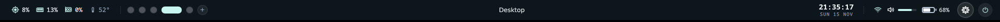
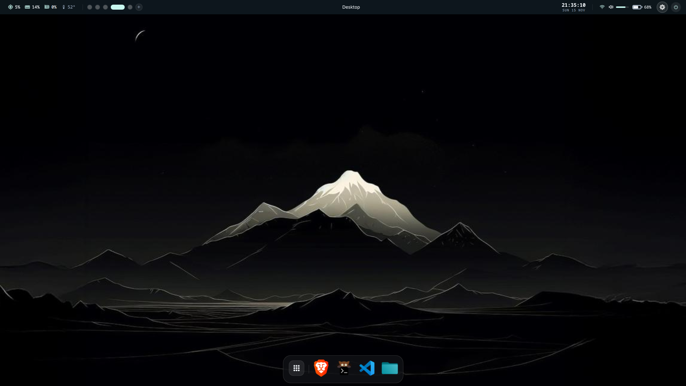
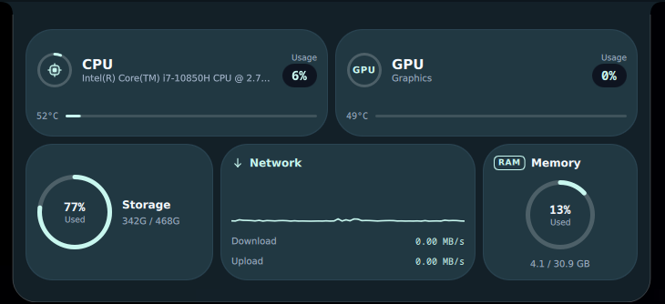
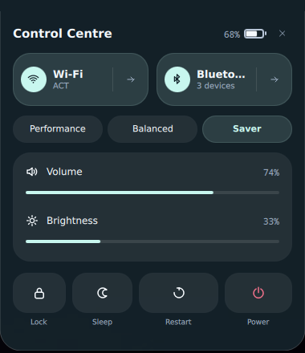
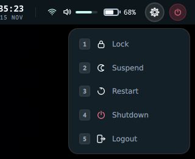
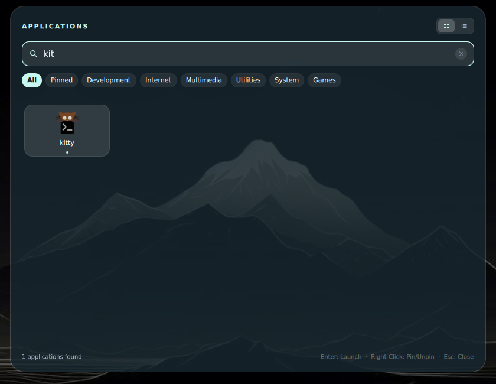
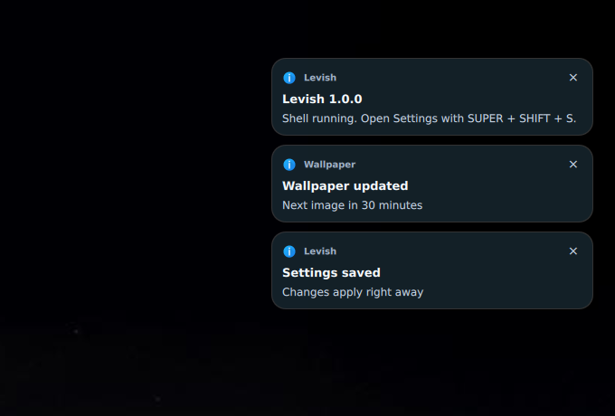
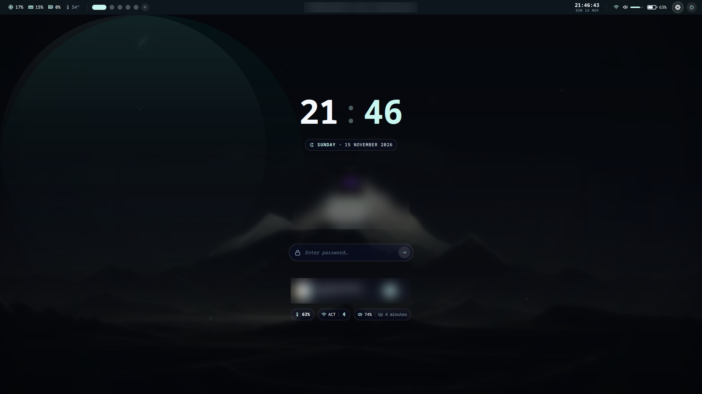
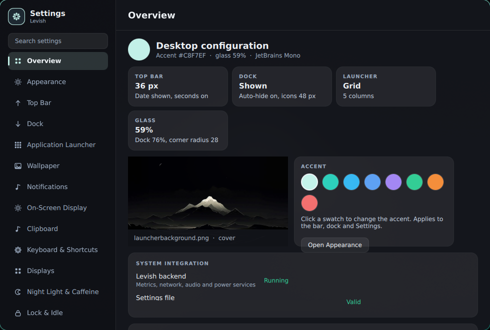

# Levish

**Levish** is a desktop shell for [Hyprland](https://hyprland.org) on Wayland. It is one coordinated set of panels rather than a pile of separate widgets: a floating top bar, an application dock, a launcher, a control center, a performance panel, notifications, an on-screen display, wallpaper management, a lock screen and a settings app. It is written in QML for [Quickshell](https://quickshell.org) (the `qs` command), with a Python backend for system state.

Version **1.0.0**. See [CHANGELOG.md](CHANGELOG.md) for what is in this release.

---

## Features

| Area | What you get |
|---|---|
| **Top bar** | Floating islands: system performance (CPU, memory, GPU, temperature), workspaces, active window title, clock with optional date and seconds, and status indicators for network, Bluetooth, audio, brightness and battery. System tray icons with menus drawn in the Levish style. |
| **Performance panel** | CPU, memory, GPU, storage, and network upload and download, with a network graph. Opens from the bar or with a keybind. |
| **Control center** | Wi-Fi (scan, connect), Bluetooth (power, devices, pair and connect), volume and mute, brightness, power profiles, media controls, and Lock, Sleep and Restart. |
| **Power menu** | Lock, Suspend, Restart, Shutdown, Logout. |
| **Dock** | Pinned and running applications, running indicators, and optional auto-hide that reveals when the pointer reaches the bottom edge. |
| **Launcher** | Grid or list view. Searches installed desktop applications and recent apps. Pinning is kept in `config/pinned-apps.json`. |
| **Notifications** | Popups at a chosen screen corner with actions, expiry and hover-to-pause, plus a do-not-disturb switch and a history of the last 100 notifications. |
| **On-screen display** | Volume, mute, brightness and keyboard-layout changes, shown briefly. |
| **Wallpaper** | Applies images through hyprpaper, scans chosen folders, optional automatic rotation, and fit modes (cover, contain, stretch, tile). |
| **Clipboard history** | Opt-in. Text only, kept in memory, cleared when the shell restarts. Pin items, delete them, and copy them back. |
| **Night light and caffeine** | Night light through hyprsunset with a colour temperature setting. Caffeine keeps the screen from idling. |
| **Lock screen** | hyprlock with a generated Levish look (four layouts). Authentication is hyprlock's own PAM. Optional auto-lock after idle and lock before sleep. |
| **Settings** | A separate settings window with an overview, a page per area, and a search that reaches individual settings. Keyboard navigation through the sidebar and results. Read-only views of Hyprland keybinds and monitors. |

Everything is configurable in Settings, and the settings are stored in one file (see [docs/CONFIGURATION.md](docs/CONFIGURATION.md)).

---

## Screenshots

**Top bar**



**Dock**



**Performance panel**



**Control center**



**Power menu**



**Application launcher**



**Notifications**



**On-screen display**


**Lock screen**



**Settings**



---

## Requirements

Levish was developed and tested on **Arch Linux (CachyOS)** with the versions below. Other versions may work.

| Component | Package (Arch) | Tested with |
|---|---|---|
| Hyprland | `hyprland` | 0.57.2 |
| Quickshell (the `qs` command) | `noctalia-qs` (AUR) | 0.0.12 |
| Wallpaper | `hyprpaper` | 0.8.5 |
| Lock screen | `hyprlock` | 0.9.7 |
| Idle locking (optional) | `hypridle` | 0.1.8 |
| Night light | `hyprsunset` | 0.4.0 |
| Python 3 with psutil, D-Bus and GObject | `python`, `python-psutil`, `python-dbus`, `python-gobject` | Python 3.14, psutil 7.2, dbus-python 1.5, PyGObject 3.58 |
| Wi-Fi | `networkmanager` (`nmcli`) | 1.58 |
| Bluetooth | `bluez`, `bluez-utils` (`bluetoothctl`) | 5.88 |
| Audio | `pipewire`, `libpulse` (`pactl`) | PipeWire 1.6 |
| Brightness | `brightnessctl` | 0.5.1 |
| Media controls | `playerctl` | 2.4.1 |
| Clipboard history | `wl-clipboard` (`wl-copy`, `wl-paste`) | 2.3.0 |

Recommended: the **JetBrains Mono** font, which is the default font family.

The official `quickshell` package from the Arch repositories also provides `qs`. It has **not** been tested with Levish. The installer uses `noctalia-qs`.

---

## Installation

### Option 1: installer (Arch, CachyOS, EndeavourOS, Manjaro)

```bash
git clone <repo-url> Levish
cd Levish
./install.sh
```

The installer installs the official packages with `pacman` (asking for your password), installs `noctalia-qs` from the AUR with `yay` or `paru` if one is present, makes the scripts executable, and runs the test suite. It does not change your Hyprland configuration. Add the autostart line yourself (see [Start Levish with Hyprland](#start-levish-with-hyprland)).

### Option 2: by hand

Install the packages in [Requirements](#requirements), then clone the repository and run `./scripts/launch.sh`.

### After a Qt update

If the shell logs `noctalia-qs was built against Qt … but the system has updated`, rebuild it:

```bash
yay -S noctalia-qs    # or: paru -S noctalia-qs
```

---

## Start Levish with Hyprland

Add this to your Hyprland config so Levish starts with your session.

**Hyprland Lua config** (`~/.config/hypr/hyprland.lua` and the files it requires):

```lua
hl.on("hyprland.start", function ()
    hl.exec_cmd("/path/to/Levish/scripts/launch.sh")
end)
```

**`hyprland.conf`** (older Hyprland versions):

```ini
exec-once = /path/to/Levish/scripts/launch.sh
```

---

## Keybinds

Levish does not register keys itself. Your Hyprland config binds each key to a function in the running shell through `scripts/levish-ipc.sh`. The examples below use the same bindings as a working Levish setup.

**Hyprland Lua:**

```lua
local levish = '"/path/to/Levish/scripts/levish-ipc.sh"'
local function lv(fn) return hl.dsp.exec_cmd(levish .. " " .. fn) end

hl.bind("SUPER + Space",         lv("toggleLauncher"))
hl.bind("SUPER + SHIFT + C",     lv("toggleControlCenter"))
hl.bind("SUPER + SHIFT + P",     lv("togglePerformance"))
hl.bind("SUPER + B",             lv("toggleDock"))
hl.bind("SUPER + Escape",        lv("togglePowerMenu"))
hl.bind("SUPER + SHIFT + S",     lv("toggleSettings"))
hl.bind("XF86MonBrightnessUp",   lv("brightnessUp"))
hl.bind("XF86MonBrightnessDown", lv("brightnessDown"))

-- The Settings window is a normal window; float and center it.
hl.window_rule({ match = { title = "^Levish Settings$" }, float = true, center = true, size = { 980, 660 } })
```

**`hyprland.conf` (older Hyprland versions):**

```ini
bind = SUPER, SPACE, exec, /path/to/Levish/scripts/levish-ipc.sh toggleLauncher
bind = SUPER SHIFT, C, exec, /path/to/Levish/scripts/levish-ipc.sh toggleControlCenter
bind = SUPER SHIFT, P, exec, /path/to/Levish/scripts/levish-ipc.sh togglePerformance
bind = SUPER, B, exec, /path/to/Levish/scripts/levish-ipc.sh toggleDock
bind = SUPER, ESCAPE, exec, /path/to/Levish/scripts/levish-ipc.sh togglePowerMenu
bind = SUPER SHIFT, S, exec, /path/to/Levish/scripts/levish-ipc.sh toggleSettings
bind = , XF86MonBrightnessUp, exec, /path/to/Levish/scripts/levish-ipc.sh brightnessUp
bind = , XF86MonBrightnessDown, exec, /path/to/Levish/scripts/levish-ipc.sh brightnessDown
windowrulev2 = float, title:^Levish Settings$
windowrulev2 = center, title:^Levish Settings$
```

| Function | Does |
|---|---|
| `toggleLauncher` | Opens or closes the application launcher |
| `toggleControlCenter` | Opens or closes the control center |
| `togglePerformance` | Opens or closes the performance panel |
| `togglePowerMenu` | Opens or closes the power menu |
| `toggleSettings` | Opens or closes Levish Settings |
| `toggleDock` | Shows or hides the dock (saved to the config) |
| `brightnessUp` / `brightnessDown` | Raises or lowers the display brightness by 5 % |
| `lock` / `unlock` / `isLocked` | Locks the screen, unlocks it (where possible), or reports the lock state |
| `toggleWallpaperRotate` | Turns automatic wallpaper rotation on or off |
| `wallpaperStatus` | Prints the current wallpaper and its fit mode |

Call any of them directly to test: `scripts/levish-ipc.sh toggleLauncher`.

---

## Running and managing Levish

| Command | Use |
|---|---|
| `scripts/launch.sh` | Start the backend and the shell (stops any running copy first) |
| `scripts/stop.sh` | Stop both |
| `scripts/reload.sh` | Restart only the UI, after you edit QML. The backend keeps running. |
| `scripts/dev.sh` | Run both in the foreground, with backend debug logging and QML errors on the terminal |

Configuration changes take effect without a restart. Edits to QML files need `reload.sh`.

---

## Settings

Open Settings with `toggleSettings` (by default `SUPER + SHIFT + S`). The sidebar lists:

Overview · Appearance · Top Bar · Dock · Application Launcher · Wallpaper · Notifications · On-Screen Display · Clipboard · Keyboard & Shortcuts · Displays · Night Light & Caffeine · Lock & Idle · About Levish

The search box finds pages and individual settings. Use the arrow keys to move through results and Enter to open one. Escape clears the search, or closes the window when the search is empty.

The **Keyboard & Shortcuts** and **Displays** pages are read-only. They show the Hyprland keybinds and monitors that are currently loaded. Changing either is not available yet.

---

## Configuration and data

| What | Where |
|---|---|
| Settings | `config/config.json` (reference: [docs/CONFIGURATION.md](docs/CONFIGURATION.md)) |
| Pinned and recent apps | `config/pinned-apps.json` |
| Runtime state (backend output, control socket, weather cache) | `/tmp/levish/` |
| Generated hyprpaper, hyprlock and hypridle configs | `~/.local/state/levish/` (your `~/.config/hypr` files are never written) |
| Backend log | `/tmp/levish-backend.log` (written by `launch.sh`) |
| Shell log | `/tmp/levish-quickshell.log` (written by `launch.sh` and `reload.sh`) |
| Quickshell's own log | `/run/user/$UID/quickshell/by-id/*/log.log` |

Clipboard history and the notification history are held in memory. Nothing from them is written to disk.

---

## Privacy and network use

- Levish sends nothing to any service by default. It has no telemetry and no update check.
- The **weather** module in the lock screen is off by default. When you turn it on, it requests conditions from `wttr.in` every 20 minutes. The request contains your configured location, or your IP address when no location is set. Turning the module off stops the requests.
- Everything else runs locally: Hyprland's IPC socket, NetworkManager, BlueZ, PipeWire and MPRIS over D-Bus.

---

## Troubleshooting

**Nothing appears.** Read `/tmp/levish-quickshell.log` and `/tmp/levish-backend.log`. Run `scripts/dev.sh` to see QML errors in the terminal.

**Notifications do not show.** Levish owns the `org.freedesktop.Notifications` name. Stop any other notification daemon (`mako`, `dunst`, `swaync`) before you start Levish.

**The shell logs `noctalia-qs was built against Qt …`.** Rebuild `noctalia-qs` (see [After a Qt update](#after-a-qt-update)).

**A new folder does not show up in the shell.** Quickshell only sees folders that exist when the UI starts. Run `scripts/reload.sh` after you create one.

**Brightness keys do nothing.** Check that `scripts/levish-ipc.sh brightnessDown` lowers the brightness. If that works, the problem is the Hyprland bind. If it fails, check that `brightnessctl g` prints a value. On some machines `brightnessctl` needs the `video` group or a udev rule to write to the backlight.

**The dock does not hide or show.** Auto-hide reveals the dock when the pointer reaches the bottom edge, and hides it 600 ms after the pointer leaves. Turn auto-hide off in Settings → Dock to confirm the dock itself works.

**Tray menus.** Levish registers the StatusNotifierItem watcher. Apps that only use the older freedesktop tray protocol do not appear.

---

## Known limitations

- The lock screen calls hyprlock with a Levish-generated config. Only reading the code has confirmed that path. Test it on your machine before you rely on it: press Lock, then unlock with your password.
- The installer supports Arch and its derivatives only. On other systems, install the packages in [Requirements](#requirements) by hand.
- The bar is not per monitor. The dock can be shown on one monitor or on all of them (`dock.monitor`).
- Clipboard history is text only.
- There is no media on-screen display (track changes do not show a popup).
- Keybinds cannot be edited from Levish. Edit your Hyprland config instead.
- The example brightness binds do not set a repeat flag, so holding a key may not keep stepping. Check your Hyprland version's documentation for the repeat option.

---

## Repository layout

```
backend/        Python backend: metrics, battery, Wi-Fi, Bluetooth, audio, MPRIS, brightness,
                power actions, Hyprland IPC, application list
quickshell/     QML shell: shell.qml (entry point), bar/, dock/, launcher/, controls/ (Control
                Center), dashboard/ (performance panel), settings/, osd/, notifications/,
                clipboard/, wallpaper/, lock/, session/, hypr/, common/ (theme and config store)
config/         config.json (settings) and pinned-apps.json
scripts/        launch, stop, reload, dev, levish-ipc, lock-screen helper scripts
tests/          Python unit tests (python3 -m unittest discover -s tests)
docs/           Configuration reference and the development feature audit
screenshots/    Images used in this README
install.sh      Installer for Arch-based systems
LICENSE         MIT license
VERSION         Release version (kept in step with quickshell/common/Version.js)
```

Run the tests with `python3 -m unittest discover -s tests -p "test_*.py"`.

---

## Documentation

- [CHANGELOG.md](CHANGELOG.md): what changed in each release
- [docs/CONFIGURATION.md](docs/CONFIGURATION.md): every setting, its type, default and range
- [docs/FEATURE_AUDIT.md](docs/FEATURE_AUDIT.md): the development audit and progress log, including what is verified and what is not

---

## License

Levish is released under the [MIT License](LICENSE).
